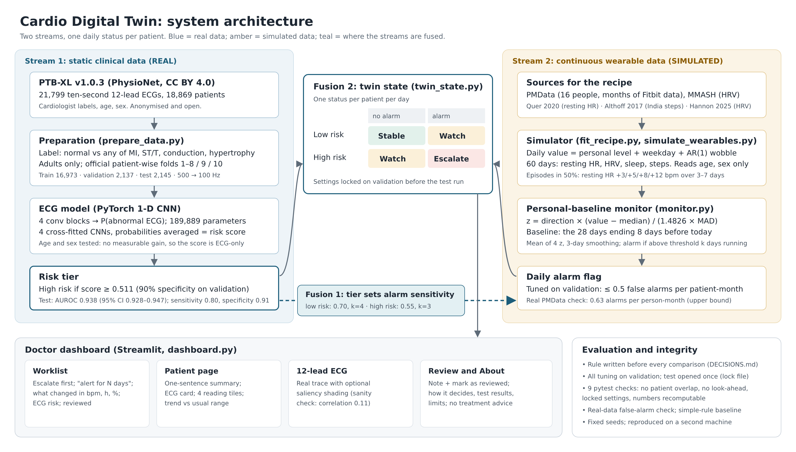

# Cardio Digital Twin

A proof-of-concept digital twin for cardiovascular risk. It reads a patient's clinic ECG to set their risk, watches their daily wearable readings against their own usual range, and tells the doctor every morning who needs attention today and why.

Submission for the **Happiest Health Digital Twin Challenge 2026** (Unstop).

| | |
|---|---|
| Demo video (YouTube, 15 min) | **https://youtu.be/ZOX2IBtFGZE** |
| Live demo (no installation) | **https://dilse.streamlit.app** |
| Code | https://github.com/priiyanka-b/dilse |
| Presentation | [docs/presentation.pdf](docs/presentation.pdf) |
| Architecture diagram | [docs/architecture.pdf](docs/architecture.pdf) |
| Decision log (every design choice, with options and reasons) | [DECISIONS.md](DECISIONS.md) |

---

## Team details

| | |
|---|---|
| Team name | **One Fold** |
| Team members | **Priyanka Bharwani** (solo entry) |
| College | **Parul University** |

## Project title

**Cardio Digital Twin: ECG-informed, personal-baseline remote monitoring for cardiovascular risk**

## Problem statement

Cardiovascular disease is a leading cause of death in India. Most patients with a heart condition are seen only at occasional clinic visits: an ECG is recorded, and then there is no information until the next visit. Meanwhile, consumer wearables record resting heart rate, heart-rate variability (HRV), sleep and activity every day. Nobody can watch thousands of patients' daily readings by hand, and a fixed population threshold (for example "resting heart rate above 100") ignores that each person has their own normal.

The challenge asks for a working model that fuses **static clinical data** with a **continuous wearable stream** and flags an adverse event or high-risk anomaly, shown on a doctor-facing dashboard, using anonymised, open-source or synthetic data.

## Healthcare use case

**Remote follow-up of cardiac patients between clinic visits.**

1. At a clinic visit the patient has a standard 12-lead ECG. The twin turns it into a risk tier (high or low).
2. Between visits, the patient wears a consumer wearable. Every day the twin compares their resting heart rate, HRV, sleep and steps with **their own** usual range from the previous four weeks.
3. The ECG risk tier sets how sensitive this monitoring is: high-risk patients get a more sensitive alarm.
4. Each morning the cardiologist or nurse opens a **worklist** sorted by status (Critical, Concern, Stable). Each patient has a plain-language reason ("High-risk clinic ECG. Daily readings have moved away from this patient's usual range for 5 days: resting HR +8 bpm, HRV −30%"). They open the patient, review the trend and the ECG, add a note and mark the patient as reviewed.

The tool supports triage. It gives no diagnosis and no treatment advice.

---

## How it works



| Stream | Data | Real or simulated |
|---|---|---|
| Static clinical data | 12-lead resting ECG plus age and sex, from PTB-XL | **Real** (anonymised, open) |
| Continuous wearable stream | Daily resting HR, HRV (RMSSD), sleep hours, steps for 60 days | **Simulated**, with every parameter taken from real wearable data or published studies |

1. **ECG model.** A 1-D convolutional neural network reads the raw 12-lead ECG and outputs P(abnormal ECG). Four copies trained on different patient groups are averaged (the final risk score). High risk = score ≥ 0.511, the cut-off giving 90% specificity on validation.
2. **Personal-baseline monitor.** For each daily reading: z = direction × (value − median) / (1.4826 × MAD), with the median and MAD (median absolute deviation) taken over the 28 days ending 8 days earlier. Heart rate rising, and HRV, sleep or steps falling, count as unhealthy. The four z values are averaged and smoothed over 3 days. An alarm needs the score above a threshold on k consecutive days.
   - **Learning twin (days 0–34, D-24).** The 28-day baseline leaves each patient unmonitored for their first 35 days. So on day 0 the twin starts from population values for people like this patient (resting HR by sex, HRV, sleep, steps), and every new day of their own data pulls its estimate towards their personal normal: the expected range starts wide and narrows (Bayesian shrinkage with an AR(1) effective sample size). From day 35 the locked monitor takes over, unchanged. The dashboard shows how much the twin already "knows" each patient (0% on day 0, about 80% by day 20).
3. **Twin (fusion of the two streams).** The ECG risk tier sets the monitor's sensitivity. Total false alarms stay at 0.5 per patient-month, but a high-risk patient is allowed twice as many as a low-risk one. Low-risk setting: threshold 0.70, k = 4. High-risk setting: threshold 0.55, k = 3. Daily status: high risk and alarm = **Critical**; high risk or alarm = **Concern**; otherwise **Stable**. (The code names these states ESCALATE, WATCH and STABLE.)
4. **DilSe app for the doctor** ("dil se", Hindi for "from the heart") (Streamlit, D-25). A morning **worklist** with status counts, "new today" badges, a 14-day heart-rate trend per patient, what changed and a **suggested next step** (Critical: contact within 24 h; Concern: review or check in within 3 days; Stable: routine; triage only, no treatment advice). A **patient page** with a one-line summary, the twin's profile of the patient (ECG risk, how much the twin has learned, alert setting, today against usual), trends with the usual range, status history and events, the 12-lead ECG with optional saliency shading, **mark as reviewed** with a note, and a one-page **PDF summary**. A **How it works** page explains the status, results and limits.

## Technical stack

| Layer | Tools |
|---|---|
| Language | Python 3.10 |
| Deep learning | PyTorch (1-D CNN, CPU training) |
| Classical ML and metrics | scikit-learn (logistic regression, ROC/AUROC, calibration) |
| Data | NumPy, pandas, wfdb (PTB-XL signal reading), openpyxl (PMData participant sheet) |
| Charts | matplotlib, Altair |
| Dashboard | Streamlit |
| Testing | pytest (13 integrity tests) |

## AI/ML model details

**ECG model (real data)**

- **Data:** PTB-XL v1.0.3: 21,799 ten-second 12-lead ECGs from 18,869 patients, labelled by cardiologists.
- **Target:** label 0 = only "normal" (NORM); label 1 = any of myocardial infarction, ST/T change, conduction disturbance or hypertrophy. All likelihood values are kept. Records with no diagnostic statement are dropped.
- **Population:** adults only (age 18 or over; the privacy code 300 is set to 90).
- **Splits:** official patient-wise folds: train (folds 1–8) 16,973, validation (fold 9) 2,137, test (fold 10) 2,145. No patient appears in two splits.
- **Input:** each lead normalised with training-set statistics only, then downsampled from 500 Hz to 100 Hz, giving 12 × 1,000 samples.
- **Architecture:** 4 blocks of [Conv1d (kernel 7) → BatchNorm → ReLU → MaxPool(2)] with widths 32, 64, 128, 128, then global average pooling and a linear output. 189,889 parameters.
- **Training:** binary cross-entropy loss, Adam (learning rate 1e-3), batch size 64, early stopping on validation AUROC.
- **Ensemble:** 4 CNNs trained by cross-fitting (fold pairs 1+2, 3+4, 5+6, 7+8; each trained on three groups for 11 epochs, seeds 42–45). The final score is the mean of the four probabilities.
- **Choices made by experiment, with rules set before each run:**
  - 100 Hz matched 500 Hz (validation AUROC 0.940 vs 0.938) and trained 5× faster;
  - a 1-D ResNet (1.02 M parameters, 0.941) did not clear the pre-set +0.005 bar;
  - adding age and sex to the ECG score gave ΔAUROC −0.0007 (95% CI −0.0025 to +0.0010), so the final score is ECG-only.

**Wearable simulation (synthetic data)**

- **Model:** daily value = personal level + weekday effect + AR(1) wobble.
- **Day-to-day memory and wobble** fitted on PMData (people with at least 60 days): resting HR φ 0.86, SD 2.04 bpm; sleep φ 0.04, SD 1.04 h; steps φ 0.14, SD 0.318 on a log scale.
- **Personal levels** from published studies: resting HR from Quer et al. 2020; steps from Althoff et al. 2017 (India mean 4,297/day); HRV level from MMASH; HRV night-to-night variation from Hannon et al. 2025 (CV 0.37). HRV memory is an assumption, set equal to resting HR.
- **No leakage:** the simulator reads only age and sex, never the ECG label.
- **Episodes:** half the patients get one. Resting HR rises +3, +5, +8 or +12 bpm over 3, 5 or 7 days, starting between days 36 and 53. HRV, sleep and steps worsen by fixed amounts per severity (design choices, not clinical facts).

**Monitor tuning:** grid search on validation only (threshold 0–4 in steps of 0.05, k 1–6). It keeps the setting with the highest mean detection subject to ≤ 0.5 false alarms per patient-month. The chosen setting was locked before the test run.

---

## Results

The test set was scored once by `final_evaluation.py`, which writes a lock file. Full output: [outputs/final_test/final_results.txt](outputs/final_test/final_results.txt).

**ECG model on 2,145 unseen test patients (real data; 57.6% abnormal):**

| Model | AUROC (95% CI) | AUPRC | Sensitivity at 90% specificity |
|---|---|---|---|
| Static only (age, sex) | 0.755 (0.734–0.775) | 0.804 | 0.436 |
| **ECG-only ensemble (final)** | **0.938 (0.928–0.947)** | **0.959** | **0.816** |
| Fused (ECG + age + sex) | 0.940 (0.931–0.949) | 0.961 | 0.830 |

- **At the locked cut-off 0.511:** sensitivity 0.804, specificity 0.912 (TP 994, FN 242, TN 829, FP 80).
- **Calibration:** Brier 0.101, ECE 0.038; mean predicted 0.538 vs actual 0.576, so slightly conservative.
- **Validation vs test:** validation AUROC was 0.942, so the model held up on unseen patients.

**Wearable monitor on simulated test patients (synthetic data):**

| Monitor | False alarms / patient-month | +3 bpm | +5 bpm | +8 bpm | +12 bpm |
|---|---|---|---|---|---|
| Fixed baseline (comparison) | 0.44 | 65.1% | 84.5% | 96.6% | 99.6% |
| Rolling personal baseline (used) | 0.51 | 76.2% | 92.9% | 97.4% | 99.3% |

**Twin on test patients:** risk adjustment raises mean detection for high-risk patients from 92.4% to 93.9% and lowers it for low-risk patients from 90.6% to 83.8%, at 0.49 false alarms per patient-month overall. The simulated episodes are independent of the ECG, so this shows how alerts are redistributed, not an outcome benefit.

**Extra checks** (validation or other data; the test set was not used again):

- **Real-world false alarms:** the locked monitor run on real PMData people (15 people, 44 person-months, 3 measures, no labelled episodes) gave **0.63** alarms per person-month, against a 0.50 budget on synthetic data.
- **Simple-rule baseline** (validation): "resting HR ≥ usual + 10 bpm for 3 days" detects 28.8% on average, against **90.0%** for our monitor. A resting-HR-only monitor reaches 89.5%, so in our simulation the other three measures add little.
- **Learning twin, days 0–34** (D-24; rules set before running; synthetic cohorts built from validation patients, plus real PMData; the test set was not used):

  | Episodes starting on days 10–28, caught within 14 days | +3 bpm | +5 bpm | +8 bpm | +12 bpm | Mean |
  |---|---|---|---|---|---|
  | Before (monitor blind until day 35) | 7.1% | 11.0% | 14.5% | 11.4% | 11.0% |
  | **With the learning twin** | **58.2%** | **91.4%** | **98.6%** | **100.0%** | **87.1%** |

  False alarms in the learning phase: 0.49 per patient-month (synthetic). On real people (PMData, first 35 days): 0.28 (low-risk setting) and 0.49 (high-risk setting) alarms per person-month, within the limits set in advance.
- **ECG saliency sanity check:** the median correlation between the trained and an untrained network's maps is 0.11 (cut-off for showing the maps: 0.7).
- **Tried and did not work: ECG heart age** (D-26; rules set before training). A second CNN, trained on healthy ECGs only, estimates age from the ECG to within **7.85 years** on the test set's healthy ECGs (correlation 0.80; R1 passed). But abnormal hearts did **not** look older than normal ones overall (gap −0.26 vs +0.53 years; R2 failed), so, as decided in advance, heart age is **not** shown in the app. An exploratory look suggests a signal in middle age (40–60) that is masked by the oldest patients; testing that would need new data.

---

## How to run

### The app only (works from this repository)

**Live demo:** **https://dilse.streamlit.app** (no installation needed)

```bash
pip install -r requirements.txt
streamlit run dashboard.py
```

The repository includes the test predictions, the simulated wearable data, the locked settings and the real 12-lead ECGs of all 2,145 test patients in a compact 8-bit copy (`data/demo/ecg_all.npz`, 36 MB, made by `export_ecg_all.py`; largest error 0.0075 mV, far below what is visible on the plot), so the hosted app shows every patient's ECG without downloading anything. If you download PTB-XL and run `prepare_data.py` to create the full-precision `data/processed/X_test.npy` (257 MB, too large for GitHub), the app uses that instead.

**Hosting it for free (Streamlit Community Cloud):** push the repository to GitHub, sign in at share.streamlit.io with GitHub, choose **Create app**, pick the repository, branch `main` and main file `dashboard.py`, and under Advanced settings choose Python 3.11. It installs `requirements.txt` (app only, no PyTorch) and gives a public link to paste above.

### Full pipeline

Install everything with `pip install -r requirements-pipeline.txt` (adds PyTorch, scikit-learn, wfdb, openpyxl and pytest).

1. **Download the data** into `data/raw/`:
   - PTB-XL v1.0.3 → `data/raw/ptb-xl/` ([PhysioNet](https://physionet.org/content/ptb-xl/1.0.3/)).
   - PMData → `data/raw/pmdata/` ([Simula](https://datasets.simula.no/pmdata/)).
   - MMASH → `data/raw/mmash/` ([PhysioNet](https://physionet.org/content/mmash/1.0.0/)).
2. **Run in this order:**

| Step | Script | What it does |
|---|---|---|
| 1 | `export_data.py` | Exploratory look at PTB-XL (labels, ages, missing data) |
| 2 | `prepare_data.py` | Labels, adult filter, official splits, `X_*.npy`, train-only normalisation statistics |
| 3 | `train_cnn.py` | Single-CNN experiments (500 vs 100 Hz, plain CNN vs ResNet) |
| 4 | `crossfit_cnn.py` | The 4 cross-fitted CNNs and their out-of-fold and validation scores |
| 5 | `fuse.py` | Static, ECG and fused models; paired bootstrap |
| 6 | `calibration_check.py` | Brier, ECE, reliability diagram; choice of final score |
| 7 | `explore_wearables.py` | Clean PMData and MMASH into daily tables |
| 8 | `fit_recipe.py` | Fit the simulation recipe (`outputs/recipe/recipe.json`) |
| 9 | `simulate_wearables.py` | 60 simulated days per validation and test patient, with episodes |
| 10 | `monitor.py` | Tune and lock the monitor on validation |
| 11 | `twin_state.py` | Tune and lock the risk-adjusted twin on validation |
| 12 | `final_evaluation.py` | **One-time** test evaluation (locks itself) |
| 13 | `real_data_check.py`, `baseline_rule.py`, `saliency.py` | Extra checks |
| 14 | `learning_twin.py` | Learning twin for days 0–34: tune, check, real-data check (D-24) |
| 15 | `export_age_data.py`, `heart_age.py` | ECG heart-age experiment (D-26, negative result) |
| 16 | `python -m pytest -v` | 13 integrity tests |

All random steps use fixed seeds. The monitor, twin and checks reproduced exactly on a second machine.

## Repository structure

```
├── README.md, LICENSE, DECISIONS.md, requirements.txt
├── *.py                      pipeline scripts (table above) and dashboard.py
├── .streamlit/config.toml    dashboard theme
├── tests/test_integrity.py   13 pytest integrity checks
├── docs/                     architecture diagram, presentation, video script
├── data/processed/           test/validation metadata and simulated wearable data (raw data not included)
└── outputs/
    ├── models/               the 4 cross-fitted CNNs (+ single-model experiments)
    ├── final_test/           locked test results, predictions, ROC and calibration plots
    ├── monitor/, twin/       locked settings and validation summaries
    ├── learning/             learning-twin settings, results and charts (D-24)
    ├── heart_age/            ECG heart-age model and results (D-26, did not pass)
    ├── crossfit/, fusion/, calibration/, recipe/, wearables_sim/, real_check/, baseline/
```

## Open-source licences

**This project's code** is released under the **MIT License** (see [LICENSE](LICENSE)).

**Data**

| Dataset | Licence | How it is used here |
|---|---|---|
| PTB-XL v1.0.3 | CC BY 4.0 | ECGs, labels, age, sex. Raw signals are not redistributed; derived metadata and predictions are included with attribution |
| PMData | The downloaded `license.txt` states **CC BY-NC 4.0** (the dataset web page states CC BY 4.0; we follow the stricter one) | Only summary parameters (`recipe.json`) are published; no PMData files or per-person data are redistributed |
| MMASH v1.0.0 | Open Data Commons Open Database License v1.0 | Only a summary (HRV level) enters the recipe; no MMASH files are redistributed |

**Software** (main libraries): PyTorch (BSD 3-Clause), wfdb (MIT), Altair (BSD 3-Clause), Streamlit (Apache 2.0), scikit-learn, NumPy and pandas (BSD 3-Clause), matplotlib (matplotlib licence, BSD-style).

## Limitations

1. The ECG model detects a **current** abnormality; it does not predict a future event. No open dataset links these ECGs to later outcomes.
2. PTB-XL was recorded in Germany (1989–1996). Performance in Indian patients is unknown.
3. It is a hospital population (57.6% abnormal), so probabilities and alert rates will not transfer directly to community screening.
4. At the locked cut-off the model misses about 1 in 5 abnormal ECGs (242 of 1,236 in the test set).
5. **All wearable data and deterioration episodes are simulated.** On real people (PMData) the alarm rate was about 1.3× the synthetic budget.
6. In the simulation, resting HR alone performs almost as well as all four measures combined.
7. The learning twin's synthetic results are optimistic: its population prior comes from the same recipe that generated the synthetic patients. Its real-data check covers false alarms only.
8. The simulated episodes are independent of the ECG, so the benefit of risk-adjusted monitoring cannot be shown with this data.
9. The risk score is slightly underconfident (mean predicted 0.538 vs actual 0.576).
10. Research prototype; not a medical device; no treatment advice.

## How the results were kept honest

- Every comparison had its decision rule written down **before** it was run ([DECISIONS.md](DECISIONS.md), D-9 to D-26). Results that failed their rules are reported too (D-26).
- All tuning used the validation set. The test set was evaluated **once**, by a script that locks itself.
- **Disclosed slip:** during a dry run of the test script, the simulated wearable test results were seen early. No setting was changed afterwards (logged in DECISIONS.md).
- Integrity tests confirm that no patient is in two splits, that the monitor and the learning twin never look ahead, that the learning twin leaves the locked days untouched, that the locked settings are unchanged, and that the headline numbers can be recomputed from the saved predictions.

## References

1. Wagner P, Strodthoff N, Bousseljot R, Samek W, Schaeffter T. PTB-XL, a large publicly available electrocardiography dataset (version 1.0.3). *PhysioNet*, 2022. https://doi.org/10.13026/kfzx-aw45
2. Wagner P, Strodthoff N, Bousseljot R-D, Kreiseler D, Lunze FI, Samek W, Schaeffter T. PTB-XL: A Large Publicly Available ECG Dataset. *Scientific Data*, 2020. https://doi.org/10.1038/s41597-020-0495-6
3. Pollard T, Moody BE, Lehman L, Gow B, Fernandes C, Xie C, Johnson A, Mark RG, Heldt T. PhysioNet as a global platform for biomedical research. *Nature Health*, 2026. https://doi.org/10.1038/s44360-026-00096-z
4. Thambawita V, Hicks S, Borgli H, et al. PMData: A sports logging dataset. OSF Preprints, 2020. https://datasets.simula.no/pmdata/
5. Rossi A, Da Pozzo E, Menicagli D, et al. Multilevel Monitoring of Activity and Sleep in Healthy People (version 1.0.0). *PhysioNet*, 2020. https://doi.org/10.13026/cerq-fc86
6. Quer G, et al. Inter- and intraindividual variability in daily resting heart rate and its associations with age, sex, sleep, BMI, and time of year. *PLOS ONE* 15(2):e0227709, 2020. https://doi.org/10.1371/journal.pone.0227709
7. Althoff T, et al. Large-scale physical activity data reveal worldwide activity inequality. *Nature* 547, 2017. https://doi.org/10.1038/nature23018
8. Hannon J, O'Hagan A, Lambe R, O'Grady B, Doherty C. Associations Between Daily Heart Rate Variability and Self-Reported Wellness: A 14-Day Observational Study in Healthy Adults. *Sensors* 25:4415, 2025. https://doi.org/10.3390/s25144415
